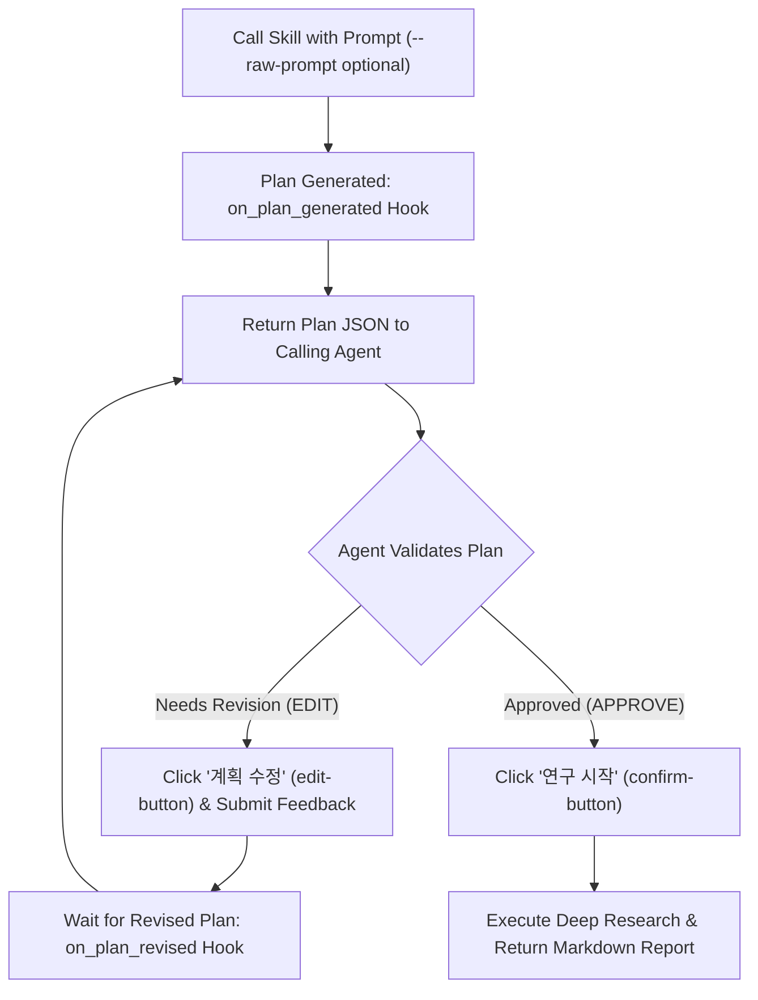

# Local Gemini App Deep Research Skill

This skill automates the locally installed **Google Gemini Windows Desktop App** (`%LOCALAPPDATA%\Google\Gemini\app-*\Gemini.exe`) via Chrome DevTools Protocol (CDP) and Playwright to execute **Gemini Deep Research** using the user's logged-in Google account without requiring an API key.

## Architecture & How It Works

1. **Automatic CDP Enablement ([patch_gemini_app.py](./scripts/patch_gemini_app.py))**:
   - Locates the latest installed `%LOCALAPPDATA%\Google\Gemini\app-*\resources\app.asar`.
   - Creates a safe backup (`app.asar.bak`) and patches `src/main.js` (preserving exact byte length and SHA256 header integrity) to enable `--remote-debugging-port=9222` and `--disable-renderer-backgrounding`.
   - Launches `Gemini.exe --hide` persistently in the background via WMI (`Win32_Process.Create`) so the window stays hidden and does not steal focus.
2. **Deep Research Execution & Plan Verification Loop ([run_deep_research.py](./scripts/run_deep_research.py))**:
   - Connects to `http://127.0.0.1:9222` using Playwright (`connect_over_cdp`).
   - Opens a new chat (`https://gemini.google.com/app`), ensures **3.8 Flash** mode is selected (`[data-test-id="bard-mode-menu-button"]`), and enables **Deep Research** (`업로드 및 도구` → `도구 더보기` → `Deep Research`).
   - Submits the prompt using native keyboard input events (`keyboard.insert_text`) — either **verbatim as passed at invocation time (`--raw-prompt`)** or as crafted by the calling agent.
   - Waits for the **Research Plan (`[data-test-id="research-steps"]`)**, cancels any auto-start countdown timer (`[data-test-id="cancel-fuse-button"]`), and expands all `"더보기"` sections to extract the full plan text.
   - **Plan Review Hook & Iterative Modification Loop** (optional):
     - Triggers the `on_plan_generated` hook and returns the full plan JSON to the calling agent.
     - The calling agent verifies the plan and either requests modifications (`EDIT: <instructions>` / `--step edit`) or approves (`APPROVE` / `--step approve`).
     - On edit, clicks **`계획 수정` (`[data-test-id="edit-button"]`)**, submits the modification instructions, waits for the revised plan (`on_plan_revised`), and returns the revised plan to the calling agent again in a loop until approved.
   - Once approved (or immediately if plan review is disabled), clicks **`연구 시작` (`[data-test-id="confirm-button"]`)**.
   - Monitors live research thoughts (`[data-test-id="thought-header"]` / `[data-test-id="thought-body"]`) until `immersive-entry-chip gem-processing-card.completed` indicates completion.
   - Extracts the pure report body from `deep-research-immersive-panel message-content` (`[data-test-id="message-content"]`) and citation links into GitHub-Flavored Markdown.

---

## Prompt & Plan Review Options

| Option | Behavior |
| :--- | :--- |
| `--raw-prompt` | **Exact Prompt Preservation**: Enters the exact prompt string provided at invocation time without any agent rewriting, expansion, or modification. When the user or calling agent requests exact prompt execution, **DO NOT alter the prompt text** and pass `--raw-prompt`. |
| `--review-plan` | **Interactive Stdin Plan Review Hook Loop**: Pauses when the plan is generated, emits `[PLAN_REVIEW_HOOK_START] ... [PLAN_REVIEW_HOOK_END]`, and waits on stdin for the calling agent to send `EDIT: <modification instructions>` (loops until satisfied) or `APPROVE` (starts research). |
| `--step plan \| edit \| approve` | **Step-by-Step Agent Loop Control**: Stateless CLI commands for calling agents to generate a plan (`--step plan`), iteratively modify and re-verify the plan (`--step edit --edit-prompt "..."`), and finally approve and execute Deep Research (`--step approve`). |
| `--plan-hook <cmd>` | **External Hook Script Loop**: Executes `<cmd>` whenever a plan is generated/revised, passing the plan JSON on `stdin` and reading `APPROVE` or `EDIT: <instructions>` from `stdout`. |

---

## Usage Workflows for the Calling Agent

### Workflow A: Iterative Plan Review & Modification Loop (Agent-Verified Plan)

Use this workflow when the calling agent (or user) should inspect and iteratively refine the generated Deep Research plan before starting the 5–15 minute research execution.



#### Method 1: Step-by-Step CLI Loop (Recommended for Calling Agents)

1. **Step 1 — Generate Initial Plan (`--step plan`)**:
   ```powershell
   [Console]::OutputEncoding = [System.Text.Encoding]::UTF8
   $env:PYTHONIOENCODING = "utf-8"
   python "$HOME\.gemini\config\skills\local-gemini-deep-research\scripts\run_deep_research.py" `
     --raw-prompt `
     --step plan `
     --prompt "<PROMPT>"
   ```
   - Reads the emitted `[PLAN_REVIEW_HOOK_START] ... [PLAN_REVIEW_HOOK_END]` JSON (`plan_text`, `iteration`, `url`).

2. **Step 2 — Verify & Iteratively Modify Plan (`--step edit`, repeat as needed)**:
   - Inspect `plan_text`. If any required subtopics, methodology, or constraints are missing, call `--step edit` with modification instructions:
   ```powershell
   [Console]::OutputEncoding = [System.Text.Encoding]::UTF8
   $env:PYTHONIOENCODING = "utf-8"
   python "$HOME\.gemini\config\skills\local-gemini-deep-research\scripts\run_deep_research.py" `
     --step edit `
     --resume-url "current" `
     --edit-prompt "<MODIFICATION_INSTRUCTIONS>"
   ```
   - This clicks **`계획 수정` (`[data-test-id="edit-button"]`)**, submits `<MODIFICATION_INSTRUCTIONS>`, waits for the newly generated plan card, and returns the revised plan JSON (`hook_event: "on_plan_revised"`).
   - Repeat **Step 2** as many times as needed until the revised plan passes verification.

3. **Step 3 — Approve Plan & Execute Deep Research (`--step approve`)**:
   - Once the plan is verified and approved, exit the loop and start the research:
   ```powershell
   [Console]::OutputEncoding = [System.Text.Encoding]::UTF8
   $env:PYTHONIOENCODING = "utf-8"
   python "$HOME\.gemini\config\skills\local-gemini-deep-research\scripts\run_deep_research.py" `
     --step approve `
     --resume-url "current" `
     --output "<OUTPUT_MARKDOWN_FILE_PATH>"
   ```

#### Method 2: Single-Process Interactive Hook Loop (`--review-plan`)

1. Launch `run_deep_research.py` with `--review-plan` (and `--raw-prompt` if preserving exact prompt):
   ```powershell
   [Console]::OutputEncoding = [System.Text.Encoding]::UTF8
   $env:PYTHONIOENCODING = "utf-8"
   python "$HOME\.gemini\config\skills\local-gemini-deep-research\scripts\run_deep_research.py" `
     --raw-prompt `
     --review-plan `
     --prompt "<PROMPT>" `
     --output "<OUTPUT_MARKDOWN_FILE_PATH>"
   ```
2. Check task output when `[PLAN_REVIEW_HOOK_WAITING_FOR_INPUT]` appears:
   - To **modify the plan**, send input to the running task via `manage_task(Action="send_input", TaskId="...", Input="EDIT: <수정할 계획 내용>\n")`. Wait for the next `on_plan_revised` payload and re-verify.
   - To **approve the plan**, send `manage_task(Action="send_input", TaskId="...", Input="APPROVE\n")`. The loop terminates, clicks **`연구 시작`**, and runs Deep Research to completion.

---

### Workflow B: Automatic End-to-End Execution (No Plan Review Loop)

When immediate execution without plan review is desired:

```powershell
[Console]::OutputEncoding = [System.Text.Encoding]::UTF8
$env:PYTHONIOENCODING = "utf-8"
python "$HOME\.gemini\config\skills\local-gemini-deep-research\scripts\run_deep_research.py" `
  --raw-prompt `
  --prompt "<PROMPT>" `
  --output "<OUTPUT_MARKDOWN_FILE_PATH>"
```

* Omit `--raw-prompt` if the calling agent was asked to expand/enrich a brief user topic into a comprehensive research prompt.
* **Prompt Guidelines**: Avoid sensitive political/election keywords (e.g., `민주주의`, `선거`, `정치`) in Korean prompts when possible, as Gemini Web's Korean content filter may block plan generation.
* When `run_command` backgrounds the task, **do not poll in a loop**. End your turn and wait for the system notification when the background task finishes.

---

### Troubleshooting & Maintenance

* **Check / Start Local Gemini App with CDP only**:
  ```powershell
  python "$HOME\.gemini\config\skills\local-gemini-deep-research\scripts\patch_gemini_app.py"
  ```
* **Show the Local Gemini App Window** (if the user wants to watch visually or re-authenticate):
  Add `--show` to either `patch_gemini_app.py` or `run_deep_research.py`.
* **Restore Original Unpatched `app.asar`**:
  ```powershell
  python "$HOME\.gemini\config\skills\local-gemini-deep-research\scripts\patch_gemini_app.py" --restore
  ```
